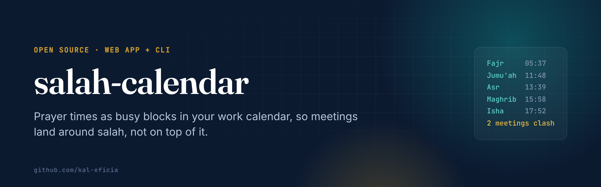
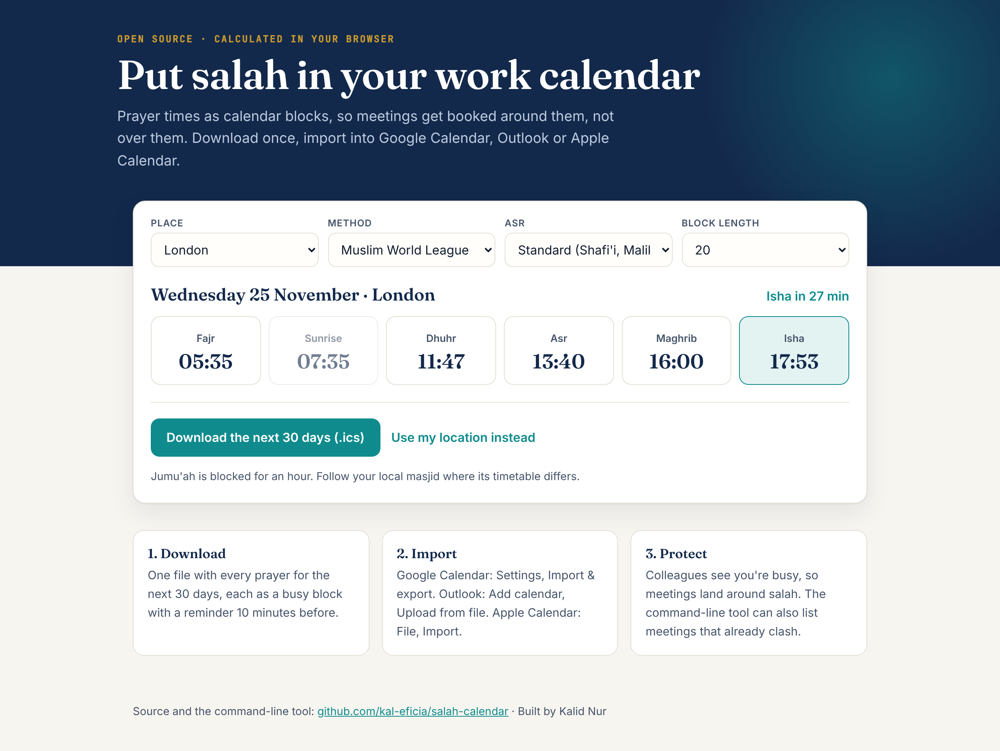

<p align="center"></p>

<p align="center">
  <a href="https://github.com/kal-eficia/salah-calendar/actions/workflows/tests.yml"></a>
  <a href="https://kal-eficia.github.io/salah-calendar/"></a>
  
  
  
</p>

If salah isn't in your calendar, someone will book a meeting over it. **salah-calendar** puts every prayer in as a busy block with a reminder, so meetings land around salah instead of on top of it.

**[Open the web app →](https://kal-eficia.github.io/salah-calendar/)** Pick your city, download 30 days, import into Google Calendar, Outlook or Apple Calendar. Nothing is sent anywhere; the times are calculated in your browser.

<p align="center"></p>

## What it does

- **Calculates the times itself** from the sun's position (solar declination and the equation of time). No API, no account, works offline.
- **The main conventions:** Muslim World League, ISNA, Egyptian Authority, Umm al-Qura (Makkah), Karachi and UAE, with Asr for the majority or Hanafi.
- **Handles UK summers.** At high latitudes the sky never gets dark enough for the usual Fajr and Isha angles, so it applies a high-latitude rule (angle-based by default, or one-seventh or middle of the night).
- **Jumu'ah** replaces Dhuhr on Fridays with a one-hour block.
- **Clash checker:** point it at an export of your work calendar and it lists every meeting that covers a prayer.

```text
$ salahcal today --city london
London · Friday 27 November 2026 · MWL, Asr shafii
  Fajr     05:37
  Sunrise  07:38
  Jumu'ah  11:48
  Asr      13:39
  Maghrib  15:58
  Isha     17:52

$ salahcal clashes work-calendar.ics --city london
2 clashes with salah:
  Thu 26 Nov 15:30-16:30  Client call  ->  Maghrib at 15:59
  Fri 27 Nov 11:30-12:30  Team standup  ->  Jumu'ah at 11:48
```

## Install and use

```bash
pip install git+https://github.com/kal-eficia/salah-calendar

salahcal today   --city birmingham --asr hanafi
salahcal ics     --city london --days 60 --minutes 20 -o salah.ics
salahcal ics     --lat 9.56 --lon 44.065 --tz Africa/Mogadishu --method MWL
salahcal clashes my-calendar.ics --city manchester
salahcal today   --city london --adjust dhuhr=2 maghrib=3    # match your masjid
```

```python
from datetime import date
from salahcal import Settings, compute
times = compute(date.today(), Settings(51.5074, -0.1278, "Europe/London", method="MWL"))
```

## Checked

- London sunrise and sunset on the longest and shortest days match the almanac to within two minutes
- every prayer comes in order, every third day of the year, in seven cities from Glasgow to Kuala Lumpur
- Fajr and Isha exist in a Glasgow June
- the JavaScript in the web app gives exactly the same times as the Python, across methods, cities and DST changes

```bash
python -m unittest discover -s tests
```

## Please note

Calculated times are a planning tool. Your local masjid's timetable, especially in the UK where many follow a fixed timetable, takes priority. Use `--adjust` to match it.

---

Built by [Kalid Nur](https://github.com/kal-eficia). MIT licence.
